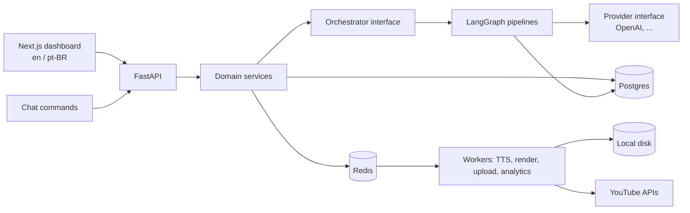

# Dark Channel Studio


A self-hosted portal that automates the lifecycle of faceless ("dark") YouTube channels with AI, while keeping a **human in the loop** where it matters: niche setup, idea research, scripting, voice, assets, deterministic rendering, thumbnail/SEO, approval, scheduled upload, and analytics that feed back into ideation.

> **Status:** design phase. This repository currently contains architecture and decisions only; no application code yet.

## Why this project

It is a portfolio piece on practical AI architecture: where agents add value (research, writing, critique), where they must not be used (rendering, uploading), and how to make that split observable, budgeted and replaceable.

## Highlights

- **Multi-channel, multi-niche** through niche templates (data, not code).
- **Agentic workflows on LangGraph**, isolated behind an internal interface, with `interrupt()` for human approval and token/cost budgets in graph state.
- **Deterministic workers** (TTS, FFmpeg/Remotion, upload) on Redis + Arq.
- **Provider abstraction**: OpenAI first; others pluggable by config.
- **YouTube-aware**: quota budgeter, audit-aware upload strategy, native `publishAt` scheduling, synthetic-media disclosure.
- **Cost and ROI tracking** per video and channel.
- **Self-hosted, local-first** via Docker Compose; UI in **en** and **pt-BR**.

## Architecture



Pipeline: `research → ideate → script ⇄ critique → (technical review) → assets/voice/render → thumbnail + SEO → human approval → scheduled upload → analytics → ideation`.

Details: [docs/design.md](docs/design.md) · Decisions: [docs/adr](docs/adr)

## Stack

| Layer | Choice |
|---|---|
| API | Python, FastAPI, Pydantic |
| Agents | LangGraph + thin LangChain layer (chat models, structured output) |
| Persistence | Postgres (domain data + `langgraph-checkpoint-postgres`) |
| Jobs | Redis + Arq |
| Rendering | FFmpeg / Remotion |
| UI | Next.js, next-intl |
| Deploy | Docker Compose, local disk storage |

## Niches

1. **English for beginners (A1/A2) for Brazilians** — first channel/MVP: short stories with dual EN/PT subtitles, vocabulary, shadowing pauses, and a review player for listening practice.
2. **Personal finance / investing** — blocking technical review gate.
3. **AI engineering / architecture** — diagrams and code on screen, blocking technical review gate.

## Key platform constraints (verified Oct 2026)

- The YouTube API cannot create channels; create Brand Accounts manually and connect each by OAuth.
- Default quota is 10,000 units/day; `videos.insert` now has its own bucket (default 100 calls/day). A quota budgeter is still required.
- Uploads from unaudited API projects are forced private until the compliance audit passes; a manual-publish fallback is planned.
- Native scheduling via `publishAt`, so the host need not be online at publish time.
- YouTube's *inauthentic content* policy (July 2025) makes human review and real differentiation core pipeline stages; synthetic-media disclosure is set when required.

## Roadmap

- [ ] **Phase 1 (MVP):** one English channel; script → voice → render → review → scheduled upload; calendar; basic metrics.
- [ ] **Phase 2:** multi-channel/niche, analytics feedback into ideation, Shorts.
- [ ] **Phase 3:** chat command interface, per-channel autonomy, A/B titles and thumbnails.

## Repository layout

```
apps/api              FastAPI service (planned)
apps/worker           Arq workers (planned)
apps/web              Next.js dashboard (planned)
packages/niche-templates  Niche template definitions (planned)
deploy                Docker Compose and env templates (planned)
docs                  Design document and ADRs
storage               Local media storage (git-ignored)
```

## License

[MIT](LICENSE)
