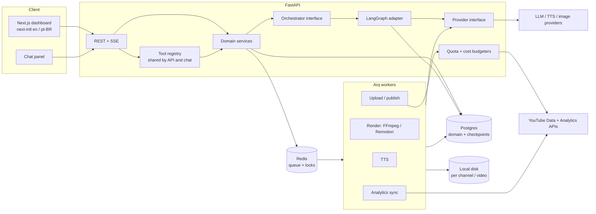
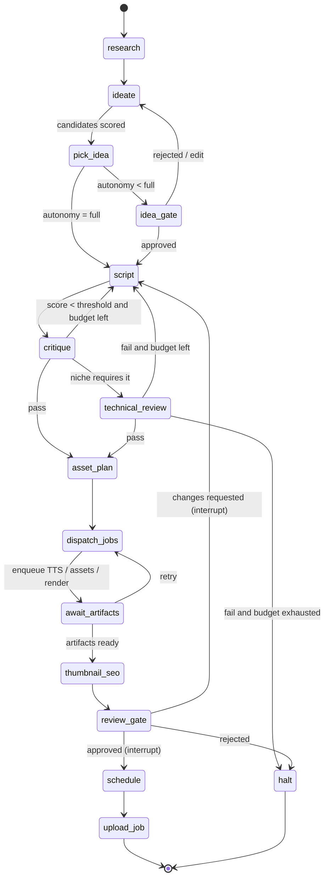
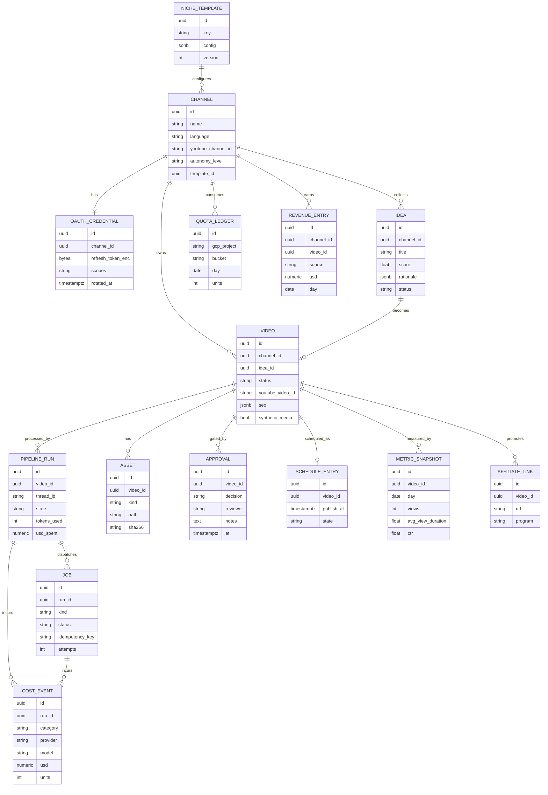

# Dark Channel Studio — Design Document

Status: **design phase** · Last verified against official docs: October 2026

## 1. Goals and non-goals

### Goals
- Automate the lifecycle of faceless YouTube channels: setup → ideas → script → voice → assets → render → thumbnail/SEO → **human approval** → scheduled upload → analytics → ideation.
- Run several channels/niches from one portal via **niche templates**.
- Keep **agentic** work (judgment, writing, planning) separate from **deterministic** work (TTS, render, upload).
- Track cost per video (LLM, TTS, assets) and ROI per channel (AdSense + affiliate).
- Be self-hosted and local-first; no vendor lock-in for AI providers or orchestration.
- Multi-language UI (en, pt-BR) from day one.

### Non-goals
- Not a SaaS or multi-tenant product (single owner, single deployment).
- No automatic channel creation (the API does not support it).
- No unattended publishing in the default configuration: a human gate is part of the product.
- No scraping, view-botting, or anything violating YouTube policies.
- Not a general video editor.

## 2. System architecture



### Component responsibilities

| Component | Responsibility |
|---|---|
| **Next.js dashboard** | Channels, calendar, pipeline status, review player, metrics, costs, settings. All strings via next-intl. |
| **FastAPI** | Auth, REST/SSE API, OAuth callbacks, thin controllers over services. |
| **Domain services** | Business rules: channels, videos, schedules, approvals, budgets. The only layer that writes to Postgres. |
| **Tool registry** | One set of typed operations (Pydantic in/out) exposed to both REST handlers and the chat agent. No logic duplicated. |
| **Orchestrator interface** | `start_run`, `resume_run(decision)`, `get_state`, `cancel`. Hides LangGraph. |
| **LangGraph adapter** | Compiles graphs, runs them, maps checkpoints/interrupts to the interface. Only package that imports `langgraph`. |
| **Provider interface** | `ChatModel`, `TTS`, `ImageGen`, `Embedding` protocols; adapters selected by config (ADR-0003). |
| **Workers (Arq)** | Idempotent, retryable deterministic jobs; no LLM decision-making. |
| **Quota/cost budgeters** | Reserve YouTube quota before upload; record spend per call; enforce per-run and per-channel caps. |

## 3. Agentic pipeline (LangGraph)

One parameterized graph per **niche template**; niche-specific nodes are swapped via the template (prompts, schemas, review rules, render preset).



- **Interrupts:** `review_gate` (always in MVP) and optional `idea_gate` call LangGraph `interrupt()` and are resumed with `Command(resume=...)` after a dashboard decision. State persists in Postgres via `langgraph-checkpoint-postgres`, so waiting for a human can last days and survive restarts.
- **Budgets in state:** `tokens_used`, `usd_spent`, `iterations` and their caps are graph state fields; conditional edges check them before any loop-back. Exhaustion routes to `halt`, never to silent retries.
- **Technical review gate:** a blocking node for finance and AI-engineering templates (fact/claim check, disclaimers, code/diagram validation); failure cannot proceed to render. Finance output is educational, never personalized advice.
- **Idempotency:** nodes are re-executed on resume, so side effects (enqueueing jobs) use deterministic job keys `run_id:node:attempt`.
- **Differentiation stage:** `critique` includes a rubric item for original angle/value-add per video to counter mass-produced content (see §7).

### Niche template (data, not code)
`prompt pack · output schemas · research sources · review rules (technical gate on/off) · render preset · subtitle/language config · CTA/affiliate slots · cadence`.

MVP template **english-a1-a2-br**: short story, dual EN/PT-BR subtitles, vocabulary cards, shadowing pauses (silence after each sentence sized to its length), and a **review player** (sentence-by-sentence loop, speed control) so the owner can practise listening/shadowing in the portal.

## 4. Data model



Domain tables are the source of truth; LangGraph checkpoint tables are owned by the library and referenced only through `pipeline_run.thread_id`.

## 5. Provider abstraction

```python
class ChatModel(Protocol):
    async def generate(self, req: ChatRequest) -> ChatResult: ...          # text + usage
    async def structured(self, req: ChatRequest, schema: type[T]) -> T: ...  # Pydantic output

class TTS(Protocol):
    async def synthesize(self, text: str, voice: VoiceSpec) -> AudioResult: ...
```

- Config (`providers.yaml` + env) maps **roles** (`script_writer`, `critic`, `tts_narrator`, `image`) to `provider/model`; templates reference roles, never vendors.
- Every call returns usage; a decorator writes a `cost_event` using a versioned price table.
- LangChain is used only inside adapters (chat models, structured output). Domain and graphs depend on our protocols.
- MVP adapter: OpenAI (chat with structured outputs, TTS). Others (Anthropic, Azure OpenAI, ElevenLabs, local) are config + adapter additions.

## 6. Jobs and queues

- **Arq** on Redis (async-native, fits FastAPI). Celery remains a fallback behind a `JobQueue` interface.
- Queues: `tts`, `render`, `upload`, `analytics`; separate concurrency (render is CPU-bound, upload is quota-gated).
- Every job: idempotency key, max attempts with exponential backoff, outputs written to disk then registered as `asset` rows, completion signalled to the run (callback resumes/advances the graph).
- Render is **deterministic**: same script + audio + preset → same video (pinned FFmpeg/Remotion versions, no LLM in the loop).
- Storage layout: `storage/<channel_slug>/<video_id>/{script,audio,assets,render,thumbnail}/`.
- Postgres `jobs` table is the durable record; Redis is transient.

## 7. YouTube integration

### Verified constraints (official docs, Oct 2026)
1. **Channels cannot be created via API.** Create Brand Accounts/channels manually, then connect each via OAuth (one credential per channel).
2. **Quota.** Default project quota is 10,000 units/day for general methods. Since the June 2026 granular-quota change, `videos.insert` and `search.list` have **their own buckets, default 100 calls/day, 1 unit each**. The older figure of ~1,600 units per upload was reduced to ~100 in Dec 2025 and then moved into its own bucket. Other costs: `videos.update` 50, `thumbnails.set` 50, `captions.insert` 400, `playlistItems.insert` 50, most `list` calls 1. Quota resets at midnight Pacific Time. Extra quota requires a compliance audit.
3. **Unaudited projects force private uploads.** Videos uploaded via `videos.insert` from unverified API projects created after 28 July 2020 are locked private until the project passes the YouTube API Services compliance audit.
4. **Native scheduling.** Upload as `private` with `status.publishAt`; YouTube publishes at that time, so the host need not be online.
5. **Altered/synthetic disclosure.** `status.containsSyntheticMedia` is settable on `videos.insert`/`videos.update`. Policy requires disclosure for *realistic* altered/synthetic content; clearly non-realistic content, AI-assisted scripts/titles/thumbnails and voice cloning of one's own voice are listed as not requiring it. Rule engine sets the flag per template and per asset type, defaulting to the conservative choice when unsure.
6. **Inauthentic content policy.** Since 15 July 2025 the YPP policy formerly called "repetitious content" is named **inauthentic content** (repetitive or mass-produced). Therefore human review and genuine differentiation are core stages, not optional polish.

Sources: YouTube Data API quota cost table, quota & compliance audits guide, revision history, and YouTube Help articles on monetization policies and AI disclosure.

### Quota budgeter
- Ledger per GCP project and bucket (`quota_ledger`), mirrored with Cloud Console numbers when reconciled.
- `reserve(units, bucket)` before every call; denied reservations defer the job to the next PT day.
- Per-channel daily upload allowance so one channel cannot starve others; cost table is configurable because Google has changed it.
- Analytics polling uses `videos.list`/`batchGetStats` (1 unit) and YouTube Analytics API on a schedule; avoids `search.list`.

### Audit and fallbacks
- Plan the compliance audit request early (use case: single-owner self-hosted tool, own channels).
- Until approved, uploads are private: the portal exports a publish checklist and offers a **manual publish fallback** (download package: video, thumbnail, title/description/tags, captions, AI-disclosure value).
- Scheduling via `publishAt` is used once uploads can be public-capable; before that, scheduling is a reminder in the calendar.

## 8. Dashboard screens

1. **Overview** — channels health, today's quota, spend, pending approvals.
2. **Channels** — setup wizard (niche template, OAuth connect, autonomy level, cadence).
3. **Ideas** — scored backlog, approve/reject/edit.
4. **Pipeline** — per-video status board, run timeline, retries, budget burn.
5. **Review** — video player with script, dual subtitles, vocabulary, shadowing loop, SEO/thumbnail preview, technical-review report; approve / request changes / reject.
6. **Calendar** — scheduled and published videos; drag to reschedule; quota hints.
7. **Metrics** — views, retention, CTR per video/channel; feedback signals into ideation.
8. **Costs and ROI** — cost per video by category, revenue (AdSense, affiliate), ROI per channel.
9. **Settings** — providers, budgets, secrets status, language, backups.

## 9. Chat tool surface (phase 3)

The chat agent is a LangGraph tool-calling agent over the **same tool registry** as REST. Destructive or spending actions require confirmation (interrupt) unless autonomy permits.

`list_channels` · `get_channel_status` · `propose_ideas` · `approve_idea` · `start_video_run` · `get_run_status` · `approve_video` · `request_changes` · `schedule_video` · `reschedule_video` · `get_metrics` · `get_costs` · `get_quota` · `set_autonomy` · `pause_channel`

Autonomy per channel: `manual` (approve every gate) → `assisted` (approve final review only) → `autopilot` (publish unless flagged); technical-review and policy gates are never bypassed.

## 10. Internationalization

next-intl with `en` and `pt-BR` message catalogs from the first screen; locale-prefixed routes; ICU plural/date/currency formatting; a CI check fails on missing keys. Backend returns codes + params for errors, never localized strings. Content language (what the video is in) is a channel setting independent of UI language. See ADR-0005.

## 11. Security

- Secrets only in `.env`/Docker secrets; `.env` is git-ignored, `.env.example` is committed.
- OAuth refresh tokens encrypted at rest (AES-GCM or Fernet, key from env/secret store, rotation supported); minimal scopes (`youtube.upload`, read-only analytics scopes added only when needed).
- Single-owner auth (password + TOTP or OIDC); portal bound to localhost/VPN by default; reverse proxy with TLS if exposed.
- Provider keys never reach the browser; logs redact tokens and prompts flagged sensitive.
- API terms: privacy policy and data-deletion path for any user data stored, per YouTube developer policies.

## 12. Observability and cost tracking

- Structured JSON logs with `run_id`, `video_id`, `channel_id` correlation.
- OpenTelemetry traces across API → graph → worker; optional LangSmith/Langfuse export behind config.
- `cost_event` per LLM/TTS/image call and per render; rolled up per video, channel, day. Budget caps enforced in graph state and in the provider decorator.
- Alerts (dashboard + optional webhook): quota > 80%, budget breach, failed job, upload locked private.

## 13. Risks

| Risk | Impact | Mitigation |
|---|---|---|
| Monetization rejection (inauthentic content) | No revenue | Human review gate, differentiation rubric, varied formats, original value per video |
| Uploads locked private | Manual publish work | Early compliance audit; manual publish fallback |
| Quota/cost changes by Google | Pipeline stalls | Configurable cost table, budgeter, reconcile with Console |
| Inaccurate finance/technical content | Harm, strikes | Blocking technical review, disclaimers, no personalized advice |
| LLM cost drift | Margin loss | Per-run/per-channel budgets, cost dashboard, cheaper model roles |
| Framework churn (LangGraph) | Rework | Orchestrator interface; domain in Postgres (ADR-0001) |
| Token leakage | Channel takeover | Encryption, minimal scopes, local-first deployment |
| Realistic-synthetic disclosure mistakes | Policy violation | Rule engine + default-to-disclose |

## 14. Phased plan

- **Phase 1 — MVP:** one English A1/A2 channel; script → TTS → render → review player → approval → upload (manual-publish fallback) → calendar → basic metrics and costs. Compose stack, Postgres, Redis, one worker.
- **Phase 2:** multi-channel/multi-niche templates (finance, AI engineering with technical gate), analytics feedback into ideation, derived Shorts, quota hardening after audit.
- **Phase 3:** chat command interface, per-channel autonomy, A/B titles and thumbnails, richer ROI.
